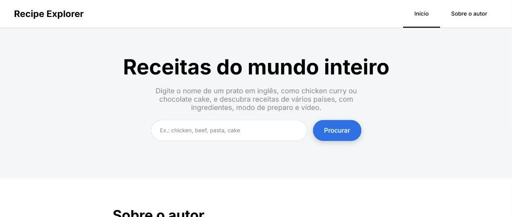
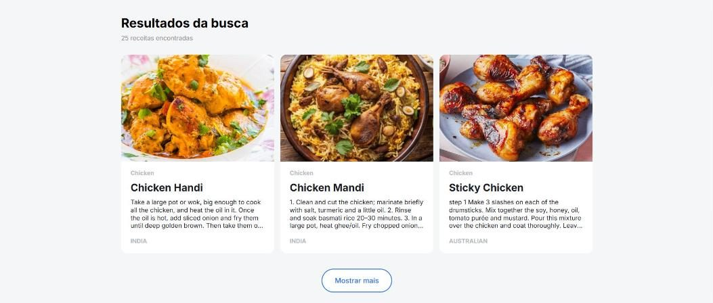
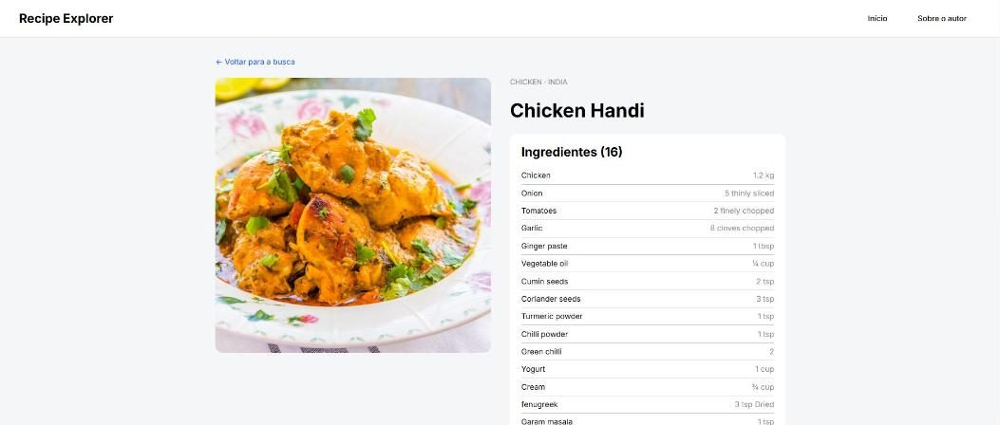
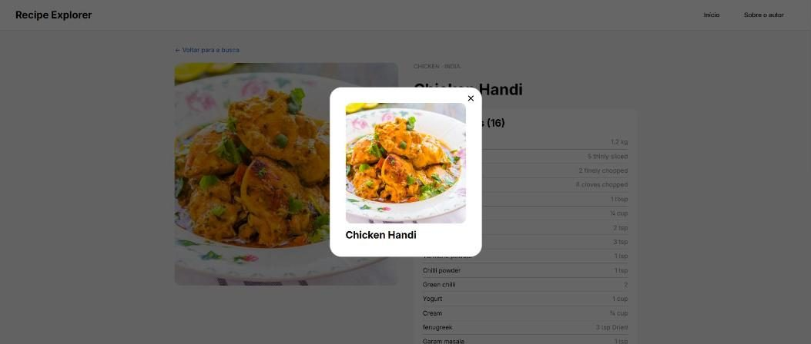

# Recipe Explorer

Aplicativo web para buscar receitas do mundo inteiro. O usuário digita o nome de um prato em inglês, vê os resultados em cartões e abre cada receita para conferir os ingredientes, as quantidades, o modo de preparo e o vídeo. Este é o projeto final do curso de Desenvolvimento Web da TripleTen, na opção **aplicativo front-end com API de terceiros**.

**Site publicado:** https://recipes-rtuttmann.networkoutpost.com

## Funcionalidades

- **Busca de receitas** pelo nome do prato, com validação do campo (não envia a busca com o campo vazio).
- **Preloader** animado enquanto a API responde, com rolagem automática até a área dos resultados.
- **Resultados em cartões**, exibidos de 3 em 3, com o botão **"Mostrar mais"**.
- Mensagens de **"Nada encontrado"** e de **erro de conexão** com a API.
- **Página de cada receita** (`/recipe/:id`): foto, categoria, país de origem, lista de ingredientes com as quantidades, modo de preparo e link para o vídeo no YouTube.
- **A última busca fica salva** no armazenamento local (`localStorage`): ao fechar a aba e voltar ao site, os resultados reaparecem.
- **Modal com a foto ampliada**, que fecha pelo botão X, pelo clique fora da janela ou pela tecla Esc.
- **Menu de navegação** com versão móvel (menu sanduíche).
- Conteúdo da API marcado com `lang="en"`, para tradutores do navegador e leitores de tela.
- **Layout responsivo**, de 320px até telas grandes, sem rolagem horizontal.

## Capturas de tela

| Página principal | Resultados da busca |
|---|---|
|  |  |

| Página da receita | Foto ampliada (modal) |
|---|---|
|  |  |

## Tecnologias e técnicas

- **React 19** com componentes funcionais e hooks (`useState`, `useEffect`, `useRef`, `useCallback`)
- **React Router 6** (rotas, `NavLink`, `useParams`, `Navigate`)
- **Vite** para o ambiente de desenvolvimento e o build
- **API Fetch** para as requisições, reunidas em `src/utils/TheMealDbApi.js`
- **localStorage** para guardar a última busca
- **CSS** com metodologia **BEM**, Flexbox e Grid, media queries e microanimações
- Fonte **Inter** conectada com `@font-face` (WOFF2 e WOFF) e **normalize.css**
- HTML semântico e acessibilidade (`aria-*`, `role`, `lang`)
- **ESLint**
- Kit de interface (UI Kit) da TripleTen
- Publicação em servidor próprio no **Google Cloud**, com **NGINX** e HTTPS (**Let's Encrypt**)

## API

Os dados vêm da [TheMealDB](https://www.themealdb.com/api.php), uma API pública e gratuita:

| Requisição | Uso |
|---|---|
| `GET /search.php?s={nome}` | busca de receitas pelo nome |
| `GET /lookup.php?i={id}` | dados completos de uma receita |

As receitas da TheMealDB estão em inglês.

## Estrutura do projeto

```
src/
├── components/   cada componente na sua pasta, com .jsx e .css
├── images/       ícones SVG
├── utils/        TheMealDbApi.js (requisições), storage.js (localStorage) e constants.js (constantes)
├── vendor/       normalize.css e as fontes
├── index.css
└── main.jsx
```

## Como rodar localmente

```bash
npm install
npm run dev
```

O site abre em `http://localhost:5173`. Para gerar a versão de produção, use `npm run build`.

## Autor

Ricardo Tuttmann — [GitHub](https://github.com/rtuttmann-web)
